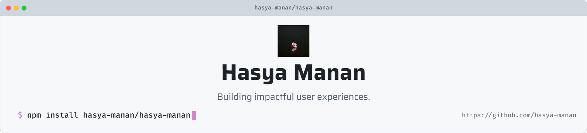

<picture>
   <source media="(prefers-color-scheme: dark)" srcset="art/header-dark.png">
   
</picture>

<h1 align="center">Hi, I'm Hasya! 👋</h1>

  <b>Full-Stack Developer | Vue.js / Nuxt & Laravel | Passionate about building impactful user experiences.</b>

  

---

### 🚀 Featured Projects

  
 

---

### 💻 Technical Skills

  

**More details:**
- **Frontend:** Vue.js, Nuxt 3
- **Backend:** Laravel (MVC Framework), PHP
- **ORM:** Prisma, Eloquent
- **APIs & Database:** REST APIs, MySQL
- **Tools & DevOps:** Git, PuTTY, cPanel, VS Code

---

### 🧑‍💻 Professional Experience

I have 3 years of experience building and maintaining production web applications in collaborative environments.

- **Developed full-stack modules** using Nuxt 3 and Vue within an existing multi-tenant application.
- **Built CRUD features** and backend logic using Laravel and PHP.
- **Implemented REST APIs** and managed SQL database interactions.
- **Performed manual production deployments** using Git and PuTTY.
- **Continuously learning** by developing mini-projects to explore new technologies and best practices.

---

### 📊 GitHub Analytics

  
   
  

---

### 📩 Contact Me

  

